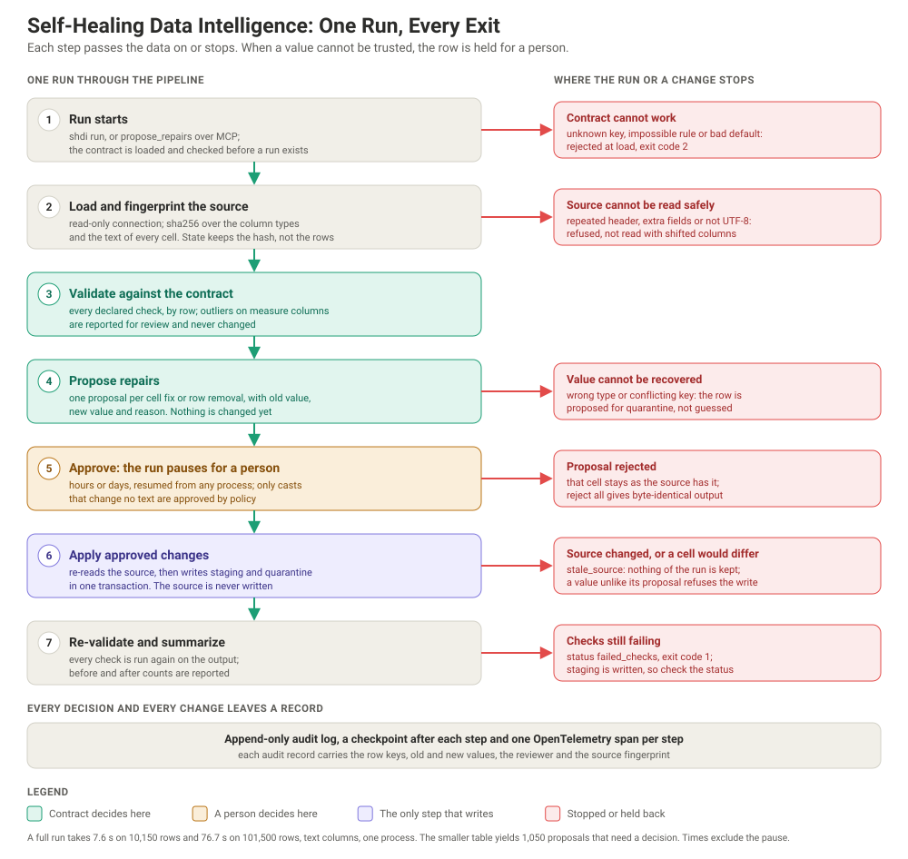
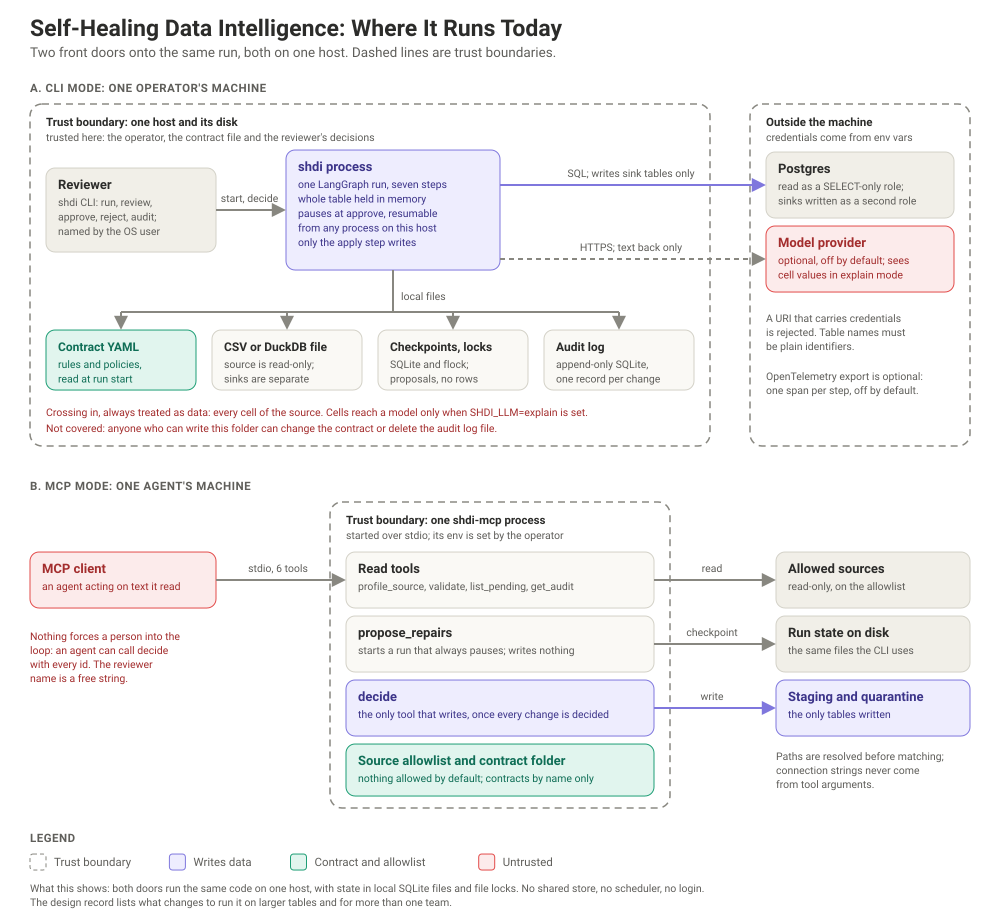

# Self-Healing Data Intelligence design record

Written 2026-11-16 against commit `4172f9b`. This is the reasoning behind the design: what the
system has to do, the choices made and what each one costs, the numbers measured so far, and what
would have to change to run it on tables a hundred times larger. The README says how to use it.
This says why it is built this way.

It is a working reference, not a production deployment. Section 7 lists what stands between the two.

## 1. The problem

A table arrives with bad rows: text in a number column, a sale entered in the wrong unit, a date in
the future, the same row twice. Two common responses both fail. Rejecting the whole load stops the
downstream work for a handful of rows. Cleaning it automatically (fill with 0, clip to a percentile)
keeps things moving and quietly replaces real values with invented ones, and nobody can later say
which numbers in the warehouse were made up.

The first version of this project did the second. It filled missing numbers with 0 and clipped each
numeric column to its 1st to 99th percentile, in a validate and repair loop, with rules hard-coded
for one sample file. A text value in a sales column became 0.

The current design answers a narrower question: given a written description of what the table
should look like, which changes are safe to make, who agreed to each one, and what exactly changed?
"Self-healing" here means the pipeline finds the defect and prepares the fix. It does not mean it
applies a fix nobody reviewed.

## 2. Requirements

What it has to do:

| # | Requirement | Where it is met |
|---|-------------|-----------------|
| R1 | Check a table against rules a person wrote down and can review, not rules guessed from the data | `shdi/contract.py`, `contracts/*.yaml` |
| R2 | Turn each failure into a specific proposed change: which rows, old value, new value, reason | `shdi/repairs.py` `propose_repairs` |
| R3 | Change nothing until a person has decided on every change that alters a value | `approve` node, `shdi/graph.py` |
| R4 | Let the review take hours and happen in another process | SQLite checkpoint, `shdi/workflow.py` |
| R5 | Never modify the source table | Read-only source connections, sinks that only write staging and quarantine |
| R6 | Record every decision and every applied change so it can be traced to a row | `shdi/audit.py` |
| R7 | Work on files and on database tables | `shdi/connectors` (CSV, DuckDB, Postgres) |
| R8 | Be usable by an agent as well as a person | `shdi/mcp_server.py` |

How it has to behave:

| # | Requirement | Design response |
|---|-------------|-----------------|
| N1 | When a value cannot be recovered, hold the row back. Do not invent a value | Type failures and key conflicts go to quarantine (D6) |
| N2 | The same input and contract give the same proposals every time | Rules only. No model in the path that produces values (D7) |
| N3 | The value written is the value the reviewer approved, exactly | Exact decimals, per-cell check before write (D8) |
| N4 | A run never applies decisions to data other than the data that was reviewed | Source fingerprint checked before apply (D4) |
| N5 | Repeating any step is harmless | Idempotent audit writes, replace-by-run sink writes, per-run lock (D10) |
| N6 | Report what was not fixed as plainly as what was | Benchmark counts restored, quarantined, neutralized and missed separately (section 5) |

## 3. Architecture

One linear LangGraph run with a single pause. Only one node writes data.

Where it runs today. Both front doors, the CLI and the MCP server, drive the same run on one host.

| Node | Reads the source | Writes | Notes |
|------|------------------|--------|-------|
| plan | no | nothing | Static plan, or model-written text when `SHDI_LLM=plan` |
| load | yes | nothing | Stores the URI, row count and sha256 fingerprint in state. Never the rows |
| validate | yes | nothing | Every contract check, plus review-only outlier findings |
| propose | yes | nothing | One proposal per cell fix or row removal, one per column for a storage cast |
| approve | no | audit (decisions) | Pauses until every `needs_approval` proposal has a decision |
| apply | yes | staging, quarantine, audit | Refuses if the fingerprint changed. Re-runs every check on the output |
| summarize | no | nothing | Before and after report |

The CLI and the MCP server are two front doors onto the same functions in `shdi/workflow.py`, so a
run started by one can be reviewed and finished from the other.

## 4. Decisions

Each decision lists the choice, the option not taken, the reason, and the cost.

### D1. Rules come from a declared contract

- **Choice.** A YAML contract per dataset: types, nullability, ranges, accepted values, primary key,
  and for each check a severity and what to do on failure (`propose_fix`, `quarantine`,
  `report_only`). Unknown keys are rejected. A contract that cannot work (a `min` on a string
  column, a default outside `accepted_values`) fails when it loads. Field names follow a subset of
  the Open Data Contract Standard where they fit.
- **Not taken.** Inferring the rules from the data, which is what the first version did (percentile
  bounds, a fixed required-column list). Or adopting an existing checker such as Great Expectations
  or Soda.
- **Why.** Bounds learned from a dirty table include the dirt: a percentile clip treats the top 1%
  of real sales as errors and lets a consistent unit mistake set the range. A contract is also the
  thing a data owner can review and sign. Existing checkers report failures well. The part this
  project is about, a per-row proposal that carries its own approval and audit record, needed the
  check result and the repair to share one row identity, so the checks are small and local.
- **Cost.** The pipeline sees only what the contract describes. In the benchmark, none of the 450
  defects of the three undescribed types is restored and two of the three types are not detected at
  all. Someone has to write and maintain the contract (`shdi infer-contract` drafts one). The check
  vocabulary is small: no cross-column rules, no checks across tables, no freshness or volume
  checks.

### D2. A repair is a proposal first, and proposals are computed in one pass

- **Choice.** `propose_repairs` returns data: rule, column, row keys, old values, new values,
  reason, risk. It never mutates its input. `apply_proposals` is the only function that produces
  changed data, and it applies only the ids it is given.
- **Not taken.** The first version's loop: repair in place, validate again, repeat up to a pass
  limit.
- **Why.** A loop that edits in place has no moment at which a person can see what is about to
  happen, and a later pass can act on values an earlier pass invented. With proposals as data, the
  review screen, the audit record and the write all come from the same object.
- **Cost.** No chained repairs. If a fix exposes a second problem, the run ends as `failed_checks`
  and the next run picks it up. One proposal per cell means many proposals: the 10,150-row benchmark
  table produces 1,050 that need a decision.

### D3. Approval is a pause inside the run, held in a durable checkpoint

- **Choice.** The `approve` node calls LangGraph `interrupt()`. State is checkpointed to SQLite, so
  `shdi approve` can run from another process or another day. Decisions can arrive in several
  batches. A cast where every value reads back as exactly its source text is `low` risk and is
  approved by policy once the last human decision is in, unless a reviewer rejected it. Everything
  else is `needs_approval`.
- **Not taken.** Apply first and report afterwards. Or a separate approval service with its own
  queue and state.
- **Why.** R3. Keeping the pause inside the graph means there is one state machine and one place
  where "decided" becomes "applied", and the framework already persists it. The low-risk rule exists
  so a reviewer is not asked to approve "store this text 42 as the integer 42" ten thousand times.
- **Cost.** A run is only as fast as its reviewer. Review is by proposal id or all at once. There is
  no "approve every rescale in this column", so a large run is in practice approve-all, which is the
  outcome the gate was meant to prevent. An unreviewed run stays paused indefinitely: there is no
  expiry and no reminder.

### D4. State holds a fingerprint, not the data, and apply refuses a changed source

- **Choice.** The checkpoint stores the source URI and a sha256 over the column types and the
  database's own text of every cell. `validate`, `propose` and `apply` each re-read the source and
  stop if the fingerprint differs. On a stale source, `apply` also deletes anything an earlier
  failed attempt of the run wrote.
- **Not taken.** Copying the rows into the checkpoint, or into a snapshot table, at load.
- **Why.** N4. Proposals name rows by position and old value, so applying them to a table that has
  moved would change the wrong cells. Keeping rows out of the checkpoint keeps customer data out of
  a second store with its own retention and access questions.
- **Cost.** The source is read in full four times per run and hashed each time. Any change to the
  table during the pause, including a new row that has nothing to do with the proposals, voids the
  run. On a table that is written continuously, a paused run never applies. This design fits batch
  landings, not live tables. The checkpoint is still not small: it holds every proposal, and a cast
  proposal lists every row of its column (section 5).

### D5. The source is never written

- **Choice.** Sources open read-only. Sinks write `<table>__shdi_staging` and
  `<table>__shdi_quarantine` and refuse any other name. Postgres takes separate read and write
  connection strings from the environment only, so the reader can be a `SELECT`-only role. Rejecting
  every proposal gives output byte-identical to the input.
- **Not taken.** Updating the source table in place inside a transaction.
- **Why.** R5. A repair tool with write access to the system of record is the most dangerous kind of
  bug to have. With staging tables the worst outcome of any defect in this code is a wrong staging
  table that can be dropped.
- **Cost.** The job is not finished when the run is. Something else has to promote staging to where
  consumers read, and someone has to work the quarantine table. Neither exists here. Every run
  writes a full copy of the table.

### D6. Quarantine before guessing

- **Choice.** What each failure becomes is fixed per check kind and can be made stricter per column.
  A value of the wrong type quarantines the row. Two rows with one key and different content are
  both quarantined. An out-of-range number is rescaled only when a unit factor declared in the
  contract brings it back in range, exactly. A missing value takes the contract default only if one
  is declared.
- **Not taken.** Best-effort coercion: read "three hundred" as 300 or as 0, keep the first row of a
  key conflict, clamp everything to the bound.
- **Why.** N1. Each of those produces a plausible number that nobody entered. The benchmark contract
  goes further and quarantines negative sales, because clamping -50 to 0 invents a sale of 0.
- **Cost.** A low repair rate, by construction: 20.0% to 22.2% of injected defects come back with
  their true value. The rest of what the contract describes is held for a person or blanked. The
  defaults still include two repairs that lose information, clamp and fill-default, which is why
  they always need approval.

### D7. The model is optional and never produces a value

- **Choice.** `SHDI_LLM=off` is the default and imports no model library. `plan` lets a model write
  the plan text. `explain` lets it write one sentence per proposal for the reviewer. `apply` never
  reads either, so output is identical with the model on or off. A model failure is noted in the
  summary and the run continues.
- **Not taken.** Letting a model propose the repaired values, which is what the name "self-healing"
  suggests and where the undescribed defects could be caught.
- **Why.** N2 and R6. A model-written value cannot be reproduced, and "the model thought so" is not
  an audit reason. The prompt would contain cell values from the source, so a row could carry
  instructions that change other rows.
- **Cost.** No semantic repair. A wrong but plausible value and a swapped day and month pass
  untouched. In `explain` mode cell values are sent to the model provider, and the explanation is
  text written from untrusted data: a hint for the reviewer, not a decision.

### D8. Values stay exact from read to write

- **Choice.** Each cell is parsed from text by strict rules (complete dates only, ASCII digits,
  64-bit integers). Numbers are compared as exact decimals. DuckDB is read through Arrow so DECIMAL,
  HUGEINT, DATE and TIMESTAMPTZ arrive as stored. Connections are pinned to UTC. When a sink column
  cannot hold a value, the column is widened. Before writing, every applied cell is compared with
  the value in its proposal and the write is refused on any difference.
- **Not taken.** Letting pandas infer types and trusting `astype`.
- **Why.** N3. `astype` turns 99.5 into 99 in an integer column without an error, a float cannot
  hold an 18-digit id, and a machine's time zone can move a date by a day. Any of these makes the
  audit log say one thing and the table hold another.
- **Cost.** Speed and code. Parsing runs per cell in Python, about 1,300 rows a second end to end on
  text columns (section 5). The value handling and the widening rules for two database dialects are the
  largest and least obvious part of the code, and most of `tests/test_review_fixes.py` exists to pin
  them down.

### D9. The audit log is append-only and names every row

- **Choice.** One SQLite table with triggers that abort `UPDATE` and `DELETE`. One record per
  decision and per applied or skipped proposal, with row keys, old and new values, reviewer, time
  and the source fingerprint. A unique key on run, proposal and event makes a repeated write a
  no-op.
- **Not taken.** Log lines. Or relying on the checkpoint history as the record.
- **Why.** R6. The question an auditor asks is "why does row 4711 say 400 when the source said
  400000, and who agreed?" That needs a query by row, and it has to survive the checkpoint being
  cleaned up.
- **Cost.** Size: the record of a cast lists every row, so the log grows with the table, not with
  the number of defects (section 5). The triggers stop a statement, not a person with access to the
  file. The reviewer is whatever name the caller gives (the OS user by default in the CLI, a free
  string over MCP). It is a label, not an authenticated identity.

### D10. Every step can be repeated

- **Choice.** `start` and `decide` take a per-run file lock. Sink writes replace the run's rows in
  both tables in one transaction (one file lock for CSV). A failed apply leaves the run
  `interrupted` with its decisions saved, and `shdi approve` retries it. A run id with audit records
  cannot be reused.
- **Not taken.** Append-only sink writes with cleanup left to the operator.
- **Why.** N5. The realistic failures are a database that was down during apply and two reviewers
  pressing approve together. Both should end in exactly one applied run.
- **Cost.** The locks are `flock` on local files and the checkpoint and audit stores are SQLite
  files, so all of this assumes one host with a shared disk.

### D11. Outliers are reported, never repaired

- **Choice.** Modified z-score on the median absolute deviation, above 3.5, only on columns the
  contract marks `measure`.
- **Not taken.** The first version's mean and standard deviation z-score and its percentile clip.
- **Why.** With |z| > 3 on mean and standard deviation, a table of 10 rows can never flag anything,
  since the largest possible score is sqrt(n - 1) = 3, and the outlier inflates the deviation it is
  measured against. An unusual value is also often true. A statistical rule gives a reason to look,
  not a replacement value.
- **Cost.** The benchmark's x10 slips are all flagged and all still in staging. Findings do not
  enter the approval flow, so nothing forces anyone to look at them.

### D12. MCP is a second front door with a narrower one

- **Choice.** Six tools over stdio. Only `decide` writes. Sources must match an allowlist that is
  empty by default, contracts are names inside one directory, connection strings never come from
  tool arguments, and a run started over MCP always pauses, even with nothing to decide.
- **Not taken.** Exposing "run and apply" as one tool. Accepting paths and connection strings from
  the client.
- **Why.** The client is a model acting on text it has read. It should not be able to point the
  tool at an arbitrary file or database, or write as a side effect of looking.
- **Cost.** The gate is only as good as the client. Nothing stops an agent calling `decide` with
  every id without showing a person anything. Enforcing a human there needs a control outside this
  server.

### D13. One trace per start or resume

- **Choice.** OpenTelemetry, off by default. A root span per start or resume, a child span per
  node, counts as attributes, and model calls as `chat` spans with `gen_ai.*` attributes. A pause
  ends its span as interrupted, not as an error.
- **Not taken.** A single trace spanning the human wait.
- **Why.** A trace that stays open for a day is not something tracing backends handle well. The run
  id on every span joins the two halves.
- **Cost.** Seeing a whole run means searching by run id across two traces. There are no metrics.

## 5. Measured results

**Repair outcomes** (`make bench`, 10,000 clean rows, seed 7, 150 defects of each type, every
proposal auto-approved). Reproduced on 2026-11-16: the output matches `bench/RESULTS.md` except for
run times.

| Measure | Text columns | Typed columns |
|---------|--------------|---------------|
| Injected defects | 1,500 | 1,350 |
| Restored to the true value | 300 (20.0%) | 300 (22.2%) |
| Quarantined for a person | 375 | 225 |
| Neutralized (set to null or the default, real value lost) | 375 | 375 |
| Missed (still wrong in staging) | 450 | 450 |
| Restored, of the defects the contract describes | 28.6% | 33.3% |
| Detection recall and precision, described types | 100% | 100% |
| Clean cells changed | 0 of 43,250 | 0 of 44,000 |
| Clean rows lost | 0 | 0 |
| Failing checks on the output | 0 | 0 |

How to read it. Only duplicates and declared unit errors come back with their true value. The
headline is not the repair rate. It is that the pipeline changed no clean cell and that every defect
it could not restore is accounted for as held, blanked or missed. All 450 missed defects are of the
three types the contract does not describe. The data is synthetic, the defects are injected one per
row by the same repository that scores them, and auto-approve stands in for a reviewer, so this
measures the rules and not review quality.

**Run time and size** (one auto-approved run through `workflow.start_run` on the benchmark's dirty
text table, where every column is VARCHAR, at two sizes. 2026-11-16, shared 4-core 2.3 GHz Xeon,
Python 3.13, local DuckDB file, one process):

| Rows in the table | Run time | Rows per second | Peak memory | Proposals | Audit log | Checkpoint data |
|-------------------|----------|-----------------|-------------|-----------|-----------|-----------------|
| 10,150 | 7.6 s | 1,336 | 332 MB | 1,053 | 7.6 MB | 6.8 MB |
| 101,500 | 76.7 s | 1,324 | 687 MB | 10,503 | 79 MB | 72 MB |

Run time is the full graph: four reads of the source, validation, proposals, apply, re-validation
and the sink write. It grows in step with the row count. The typed table (BIGINT, DATE, DECIMAL,
TIMESTAMPTZ) is faster, 5.5 s against 7.3 s inside the 10,000-row benchmark, because its values
arrive already typed.

The state grows with the table, not with the number of defects. At 10,150 rows the three cast
proposals, one per non-string column, are 1.6 MB of proposal JSON, stored once as a decision and
once as applied, because each lists every row with its old and new text. The checkpoint store
holds 9 checkpoints per run, and each one after `propose` carries all the proposals. The typed table needs no casts, so its records cover only its 900 proposals.

**Reviewer load.** The 10,150-row text table produces 1,053 proposals: 1,050 need a decision and 3
casts are approved by policy. The 101,500-row table produces 10,503.

**Tests.** 133 pass in 47 seconds with no network. 10 more need a Postgres server and are skipped
without one. A 500-row benchmark runs inside the suite and fails if any outcome share moves.

Not measured: Postgres at any size beyond the test fixtures, concurrent runs, model cost and latency
in `plan` or `explain` mode, and how long a person takes to review a run.

## 6. What can go wrong, and what happens

| Situation | What the system does | What is left |
|-----------|----------------------|--------------|
| Source changes while the run is paused | Apply refuses, status `stale_source`, any partial output of the run is deleted | The review effort is lost. A busy table never applies |
| Database down or file moved during apply | Run stays `interrupted` with decisions saved. `shdi approve` retries | None known |
| Two reviewers decide at once | Per-run lock. The run applies once | Single host only |
| Same decision sent twice | Ignored and reported as `ignored`. No second audit record | None known |
| Sink column cannot hold an approved value | Column is widened. Write refused if a cell would still differ | Staging column types can drift from the source over runs |
| Contract has a typo or an impossible rule | Rejected at load, exit code 2 | A contract that is valid and wrong is applied as written |
| Model unavailable or returns nothing useful | Noted in the summary. Run continues without explanations | None |
| A cell contains text aimed at the model | The model's text is shown to the reviewer and never read by apply | The reviewer can be misled by the explanation |
| MCP client names a file or table outside its remit | Refused by the allowlist after resolving `..` and symlinks | `*` in a pattern also matches `/` |
| Table name used to read a file in DuckDB | Names limited to plain identifiers, external access switched off | None known |
| Checks still fail after apply | Status `failed_checks`, exit code 1, staging is written anyway | The consumer has to check the status before using staging |
| Someone edits the audit file directly | Nothing | Needs storage the pipeline user cannot write |
| Ambiguous date such as 01/06/2024 | Read month first, flagged, always needs approval | A reviewer approving in bulk will not notice |

## 7. What stands between this and production

1. **It reads the whole table into memory.** Every node that needs rows loads all of them into one
   pandas frame.
2. **State is local files.** Checkpoints, the audit log and the locks are SQLite and `flock` under
   one folder. Two hosts cannot share a run.
3. **Reviewer identity is self-declared.** There is no login, no roles, and no rule that the person
   who started a run cannot approve it.
4. **Review does not scale past a screenful.** Decisions are per proposal id or all at once.
5. **Nothing promotes staging.** There is no publish step, no handling of the quarantine table, and
   no scheduler or trigger. A person or an agent starts each run.
6. **A paused run needs a quiet source.** Any change voids it.
7. **Full table every time.** No incremental or partition-level runs.
8. **Three connectors.** No warehouse or lakehouse connector, no lineage output.
9. **The audit log can be deleted by whoever can delete the file.**
10. **No metrics or alerts.** Spans only.
11. **The benchmark is synthetic and self-written.**

## 8. What changes at 100 times the scale

Nothing in this section is built. It is where the current seams are and what goes behind them. A
hundred times the benchmark is a million rows per table. If the measured rate held, that run would
take about 13 minutes on one core and hold several gigabytes in memory and in state files, which is
slow but possible. A hundred times that is not, and that is where the design has to change, not the
tuning.

| Area | Today | At scale | Seam that already exists |
|------|-------|----------|--------------------------|
| Checks | Per-cell Python over a full pandas frame | Compile each contract check to SQL and run it in the engine that holds the data. Only failing rows come back to Python | A check is already a declared kind plus a column and a policy, not code |
| Proposals | One per cell, each listing its rows | One per rule and column with a predicate, a row count and a sample. Row-level detail is written as a table at apply | `rule`, `column` and `check_ids` are already on every proposal |
| Casts | A proposal that lists every row | A schema-level proposal: "store `sales` as number, 0 values change" | Risk is already computed from whether any text changes |
| Review | By proposal id, or all | By group: approve every rescale in a column after seeing a sample and the distribution, reject individual rows out of it | Risk levels and the policy approver (`policy:low-risk`) |
| Source consistency | sha256 of every cell, four reads, any change voids the run | Pin a snapshot: a table version in Delta or Iceberg, a Snowflake time-travel timestamp, or an immutable landed partition. Run per partition | The fingerprint is one string in state. A snapshot id fits the same field |
| Apply | Build the output frame in Python, write a full copy | Generate `MERGE` or `INSERT ... SELECT` from approved proposals and run it in the warehouse | `Sink.write_run(staging, quarantine, run_id)` is the only write call |
| Run state | SQLite file, `flock` | Postgres checkpointer and advisory locks, workers that hold no state | `build_graph(checkpointer=...)`, one `run_lock` function |
| Audit | SQLite with triggers, one JSON blob per proposal | Append-only table in the warehouse or object storage with write-once retention, one row per changed cell, partitioned by run | Records are already keyed by run, proposal and event and written through one `record()` call |
| Identity | A name passed by the caller | SSO for reviewers, the authenticated name on every decision, a rule that the run's starter cannot approve it | `reviewer` is already on every decision record |
| Orchestration | Started by hand | A task in Airflow or Dagster after each landing, with the pause surfaced as a waiting task and a publish step after `passed` | Exit codes and `status` already distinguish waiting, passed, failed and stale |
| Contracts | Files in a folder | Versioned in git with the pipeline code, owned by the data owner, reviewed by pull request | A contract fingerprint function exists. It is not yet written to the audit record |
| Model use | Optional sentence per proposal | One explanation per group, and possibly drafting contract rules from profiles for a person to accept. Still never values | `ChatModelFactory`, off by default |
| Observability | Spans per node | The same spans plus metrics: rows checked, defects per check, approval wait, quarantine backlog, stale runs | OpenTelemetry already wired |
| Evaluation | Seeded synthetic defects | Defect labels from real incidents, and the same CI gate on outcome shares | `bench/score.py` and the smoke test |

The order to do them in: push checks and apply down into SQL first, since nothing larger than
memory works without it. Then grouped proposals and review, because a million-row table with the
same defect rate would produce about a hundred thousand decisions. Then snapshot pinning, shared
state and identity. The contract, the proposal as the unit of review, the staging-only write and the
audit record are the parts that stay the same.
